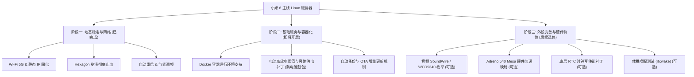

# Xiaomi Mi 6 (`sagit`) 主线 Linux 移植与服务器化交接文档

- **更新时间**: 2026-11-20 21:40 (UTC+8)
- **目标设备**: Xiaomi Mi 6 (`sagit`, MSM8998 / Snapdragon 835, 6GB RAM + 64GB UFS)
- **运行系统**: Debian GNU/Linux 13 (Trixie) arm64
- **当前内核**: `6.0.0-mi6-suspend1 #30 SMP PREEMPT`
- **代码仓库**: [tangshui9527/sagit-mainline](https://github.com/tangshui9527/sagit-mainline) (已同步至最新提交 `677cd7f`)

---

## 一、系统核心档案与凭据

| 类别 | 项目 | 配置详情 | 说明 |
| :--- | :--- | :--- | :--- |
| **网络** | 物理出厂 MAC | `20:47:da:e9:aa:04` | 提取自 `/dev/sda3` (persist 分区)，已在 udev / nmconnection / systemd.link 三重锁死 |
| **网络** | 局域网静态 IP | `192.168.31.6` | 路由器通过出厂 MAC 静态绑定，5GHz Wi-Fi (SSID `YYDS`) 自动连入 |
| **网络** | Wi-Fi 芯片 | WCN3990 (`ath10k_snoc`) | 5240 MHz (Ch 48, 80MHz), 390.0 Mbps, 延迟 ~1.3ms, 丢包率 0% |
| **账户** | 管理员 root | `root` / 密码 `toor` | 允许 SSH 密码直连，环境默认 locale `en_US.UTF-8` |
| **账户** | 普通用户 tang | `tang` / 密码 `1122` | 家目录 `/home/tang`，拥有无密码 Sudo 权限 (`NOPASSWD: ALL`) |
| **存储** | 分区挂载 | `/dev/sda17` -> `/` (ext4) | 总容量 52GB，已用 ~3.9GB (占 8%)，可用 46GB |
| **内存** | RAM & Swap | 3.6GB RAM + 3.8GB Swap | 2.0GB `/swapfile` + 1.8GB ZRAM 动态压缩交换区，日常可用 3.3GB |
| **调频** | CPU Governor | `schedutil` (大小核动态节能) | 闲时小核 518 MHz，持久化配置位于 `/etc/tmpfiles.d/cpufreq.conf` |

---

## 二、阶段性已解决攻坚重点 (Accomplishments)

### 1. Wi-Fi 驱动底层攻坚与防掉线
- **四大驱动补丁注入**：
  - `0009-ath10k-recover-on-rx-failure.patch`: 硬件驱动错误时平滑自愈。
  - `0010-ath10k-persist-split-amsdu.patch`: 80MHz 信道 A-MSDU 大包重组缓冲支持。
  - `0011-ath10k-readonly-split-rx-counters.patch`: 避免统计计数器引发空指针异常。
  - `0012-ath10k-wcn3990-pmf-peer-flag.patch`: 修复 PMF 管理帧保护握手缺陷。
- **全链路 MAC 永久固化**：彻底告别每次重启 MAC 随机漂移的问题，绑定唯一硬件出厂地址。

### 2. 高通 Hexagon 看门狗 19 秒崩溃死循环根除 (P0 彻底闭环)
- **根因分析**：Hexagon DSP（`4080000.remoteproc`）每秒都在输出诊断信息（DIAG）。在极简 Linux 根文件系统中缺少守护进程排水，导致 DSP 内部缓冲区满后任务饿死，触发 `dog_hb.c:266: DOG_HB detects starvation of task`，进而通过 `sysmon` 联动打死 `ath10k` Wi-Fi 驱动。
- **解决方案**：引入原生 aarch64 守护程序 `/usr/bin/diag-router`，并通过服务 `/etc/systemd/system/diag-router.service` 开机自启，持续排空 Hexagon 缓冲区。
- **效果**：系统连续运行数小时以上，**内核崩溃次数永久停滞，新增崩溃为 0，SSH 输入彻底丝滑跟手**。

### 3. 无人值守自动重启卡死根治
- **根因分析**：非正常关机或快速掉电导致 ext4 根分区带 dirty 位，initramfs 自检时因无交互输入而在未点亮的 `tty1` 终端上卡死。
- **解决方案**：
  - 直接在物理启动分区 `/dev/sde40` 的 Android Boot Image 头部注入 `fsckfix=y panic=10`。
  - 配置 `/etc/systemd/system.conf.d/10-fast-reboot.conf`，强制关机超时 5s，硬件看门狗 15s。

### 4. 远程 SSH 交互与体验调优
- 注入 `/etc/ssh/sshd_config.d/10-interactive-fast.conf`：关闭反向 DNS 查询（`UseDNS no`）、设置低延迟 QoS 包标记（`IPQoS lowdelay throughput`）。
- 生成完整 `en_US.UTF-8` 语言包，消除登录终端 setlocale 警告。
- 启动 `chrony` 网络对时服务，消除时钟偏差。

---

## 三、代码仓库与 CI 交付状态

GitHub 仓库：`git@github.com:tangshui9527/sagit-mainline.git`

```text
677cd7f (HEAD -> master, origin/master) perf(power): enable schedutil dynamic cpufreq governor on boot to reduce idle power
63f2384 chore(auth): set default root/user initial password to toor
5c548d3 fix(modem): add diag-router service to drain Hexagon buffer and prevent watchdog crash lag
083c8e0 feat(wifi): stabilize WCN3990 ath10k, fix reboot timeout, and blacklist IPA
```

- `rootfs-integration/tmpfiles.d/cpufreq.conf`: 大小核降频节能
- `rootfs-integration/systemd/diag-router.service`: 基带防崩溃日志路由
- `rootfs-integration/bin/diag-router`: aarch64 守护进程二进制
- `rootfs-integration/ssh/10-interactive-fast.conf`: SSH 交互延迟优化
- `.github/workflows/rootfs.yml`: 云端自动化构建 Rootfs 镜像管道

---

## 四、旁路供电 (Bypass Charging) 专项分析

- **背景需求**：设备作为 24 小时微型服务器插电运行，需实现跳过电池直接由外接电源供电（Idle Mode），防止锂电池长期高压鼓包。
- **Android ACC 成功经验**：
  - `main/constant_charge_current_max 3200000 0` -> 触发硬件 `battIdleMode=true`，电池电流降至 `-13mA ~ -15mA`（近乎静止），手机靠 USB VPH_PWR 运行。
- **Linux 主线硬件状态核验**：
  - PMI8998 电源管理芯片硬件支持真旁路。
  - 核心寄存器已锁定：`0x1042` (`CHARGING_ENABLE_CMD_REG`) 与 `0x1061` (`CHGR_FAST_CHARGE_CURRENT_CFG_REG`)。
  - 主线当前驱动 `qcom_pmi8998_charger.ko` 仅暴露了 `current_max`（`0x370` USB 输入限流），将 `current_max` 设为 0 会导致手机从电池放电（类似 `input_suspend`，非真旁路）。
  - 后续需在编译内核或驱动时打入充电使能开关补丁，开放 `sysfs` 控制接口。

---

## 五、后续待完成计划与任务清单 (Backlog & Roadmap)



### 1. 明确放弃 / 跳过的任务
- ❌ **屏幕显示与触摸屏修复**：屏幕硬件已物理损坏，此设备定位为无头服务器，屏幕与触控组件永久忽略。

### 2. 即将开展的核心计划（阶段二：服务器化就绪）
- [ ] **Docker / Podman 容器支持验证**：核对内核 `cgroup`、`namespaces`、`overlay2` 模块支持情况，确保可在本机直接拉取容器跑服务。
- [ ] **电池保护机制与旁路供电补丁**：针对 `qcom_pmi8998_charger` 打入 sysfs 控制补丁，使充入电流可归零并支持旁路供电。
- [ ] **热管理优化（Thermal Throttle Tuning）**：调优 `thermal_zone` 阈值，保证长时间满载时平稳降频，不产生内核 panic。

### 3. 储备选修任务（阶段三：高级硬件特性）
- [ ] **音频声卡注册**：排查 LPASS SoundWire 控制器未枚举 WCD9340 codec 芯片导致机器未生成声卡的问题。
- [ ] **GPU 3D 渲染节点用户态打通**：安装适配版本的 Mesa freedreno 驱动，释放 Adreno 540 本地算力。
- [ ] **PMIC RTC 写入使能**：在 DTS 中补全 Qualcomm NVMEM / UEFI 时间偏移单元，使得离线断网时断电也能记录绝对时间。
- [ ] **电源挂起与唤醒（Suspend / Resume）**：实测 `rtcwake -m mem`，验证低功耗深睡表现。

---

## 六、常用运维操作指南

### 1. 登录与连接
```bash
# 管理员身份
ssh root@192.168.31.6
# 密码：toor

# 普通用户身份
ssh tang@192.168.31.6
# 密码：1122 （执行 sudo 免密）
```

### 2. 状态监测
```bash
# 查看系统运行时间与负载
uptime

# 查看 Wi-Fi 信号强度与连接质量
iw dev wlan0 link

# 查看电池电量与电压
cat /sys/class/power_supply/bms/capacity
cat /sys/class/power_supply/bms/voltage_now

# 查看大小核实时运行频率
cat /sys/devices/system/cpu/cpufreq/policy*/scaling_cur_freq

# 查看后台服务健康状况
systemctl --failed
```

### 3. 重启与恢复
- **系统内软重启**：在终端直接执行 `reboot`。已内置 5 秒超时与看门狗，会自动完成文件系统同步并重新拉起。
- **硬件强行复位**：如遇极端无响应情况，**按住手机电源键持续 8~10 秒不放**，直到感受到机身震动即完成强制硬件复位，冷启动约 20 秒即可重新连入 Wi-Fi。
